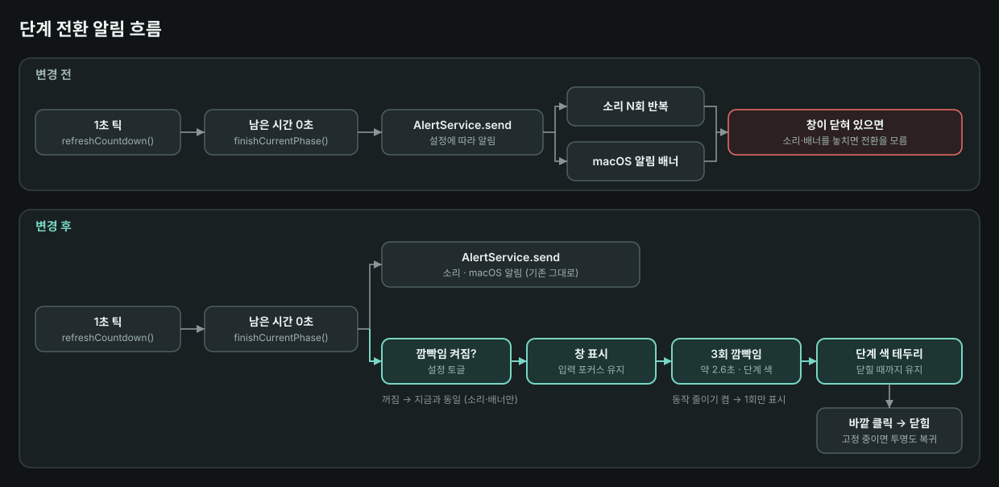
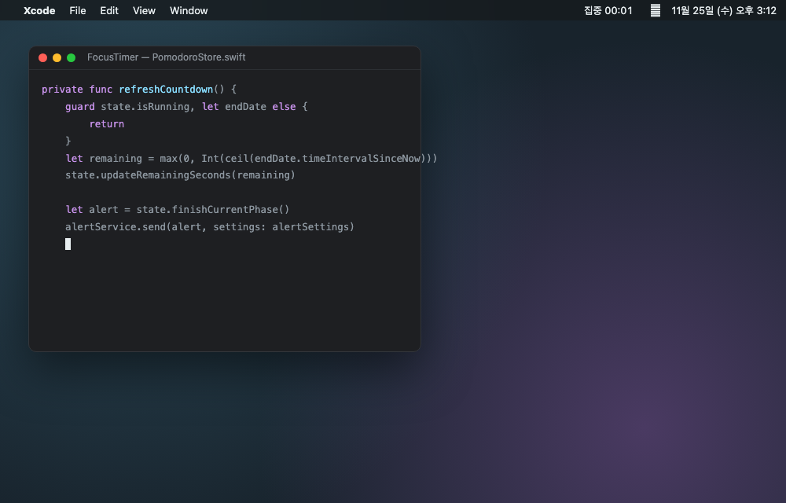
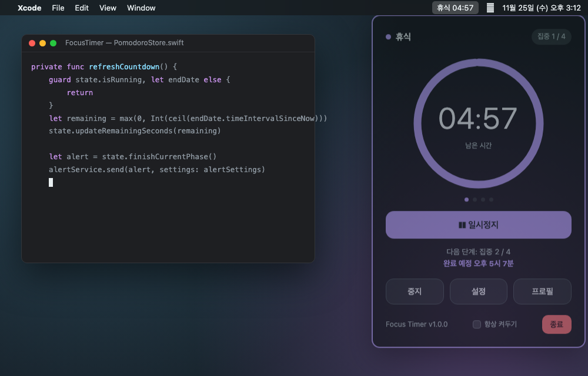
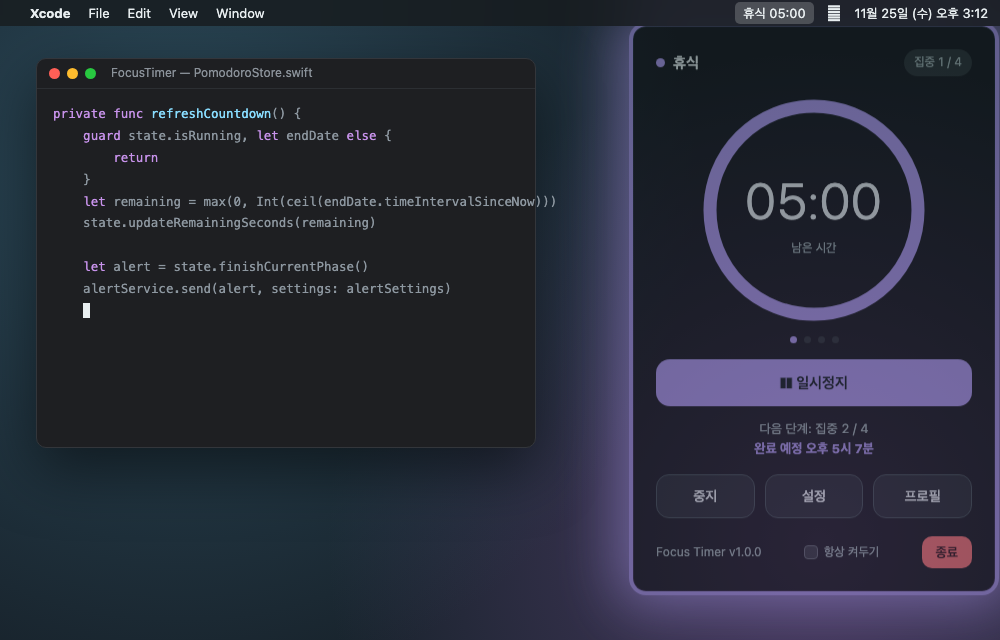
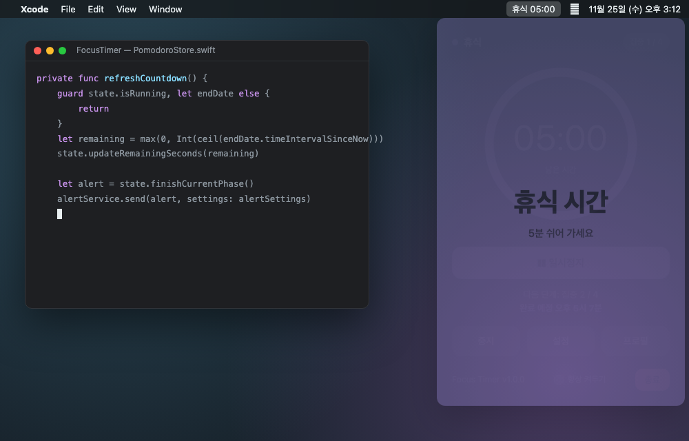
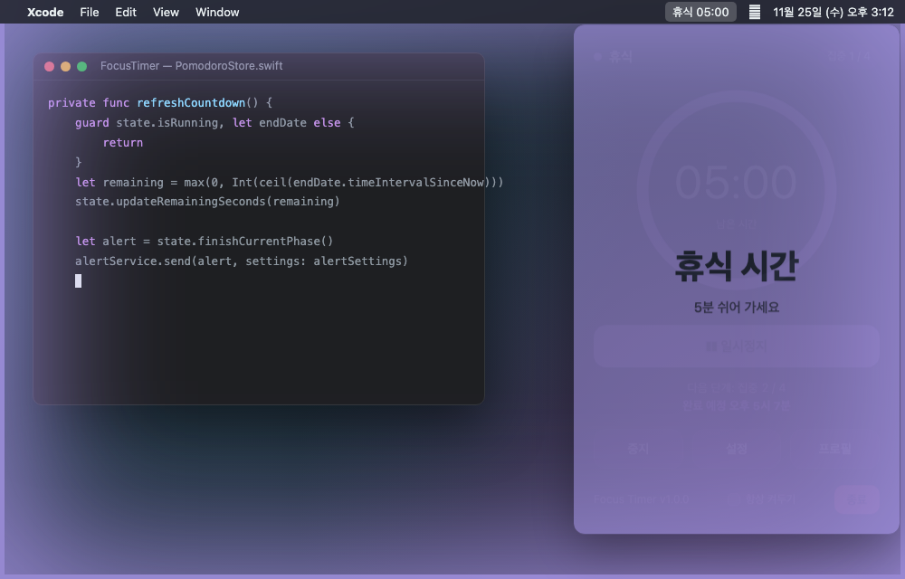
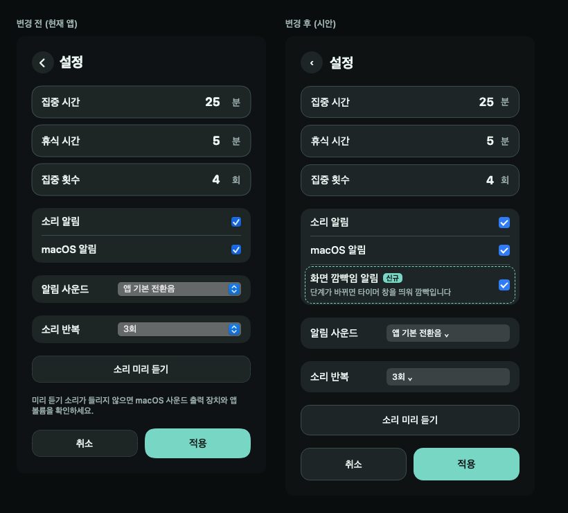

# 화면 깜빡임 알림 — 샘플 UI 보고

- 작성: 2026-11-25 15:17 KST
- 상태: **B안으로 구현 완료** (2026-11-25). 결정 사항 3개 모두 추천안대로 확정 — B안, 완료 시에도 깜빡임, 기본값 켜짐
- 동작하는 샘플: [`assets/261125-1512-화면깜빡임알림-샘플UI.html`](assets/261125-1512-화면깜빡임알림-샘플UI.html) — 브라우저로 열면 전환 버튼·자동 진행으로 직접 확인할 수 있습니다. 외부 리소스 없이 로컬에서만 동작합니다.

## 목차

1. [요약](#1-요약)
2. [변경 전 / 개선안 비교](#2-변경-전--개선안-비교)
3. [깜빡임 방식 3안](#3-깜빡임-방식-3안)
4. [전환 순간의 순서](#4-전환-순간의-순서)
5. [설정 화면](#5-설정-화면)
6. [UX 판단 근거](#6-ux-판단-근거)
7. [구현 방향 (승인 후)](#7-구현-방향-승인-후)
8. [결정 요청 사항](#8-결정-요청-사항)

## 1. 요약

타이머가 진행 중일 때 집중 → 휴식, 휴식 → 집중으로 **자연 종료 전환**이 일어나면, 타이머 창이 닫혀 있어도 메뉴 막대 아래로 열리면서 **단계 색(집중 민트 / 휴식 보라)으로 3회 번쩍**입니다.

깜빡임은 약 2.6초로 끝나고, 그 뒤에는 단계 색 테두리만 남습니다. 창은 지금처럼 **바깥을 클릭하면 닫힙니다.**

창은 **입력 포커스를 빼앗지 않습니다.** 다른 앱에서 타이핑 중이어도 키 입력은 그대로 그 앱으로 갑니다.

설정 화면의 알림 묶음(소리 알림 · macOS 알림) 아래에 **화면 깜빡임 알림** 체크박스 한 줄을 추가해 켜고 끕니다.

추천안은 **B. 창 전체 깜빡임**입니다. "번쩍번쩍해서 명확히 인지"라는 요구에 가장 직접적이면서, 추가 창 없이 기존 패널 안에서 끝나 구현이 작습니다.

## 2. 변경 전 / 개선안 비교

| 구분 | 변경 전 | 개선안 |
| --- | --- | --- |
| 전환 시 창 | 닫혀 있으면 그대로 닫혀 있음 | 닫혀 있어도 메뉴 막대 아래로 열림 |
| 시각 신호 | 메뉴 막대 글자만 `집중` → `휴식`으로 바뀜 | 창 전체가 단계 색으로 3회 번쩍 + "휴식 시간" 크게 표시 |
| 인지 수단 | 소리(N회) · macOS 배너 | 소리 · 배너 + 화면 깜빡임 |
| 자리 비운 사이 전환 | 돌아와도 알 수 없음 | 창이 열린 채 단계 색 테두리로 남아 있음 |
| 입력 포커스 | — | 빼앗지 않음 |
| 끄기 | — | 설정의 **화면 깜빡임 알림** 체크 해제 |

전환 전 화면입니다. 창은 닫혀 있고 메뉴 막대에만 남은 시간이 보입니다.

깜빡임이 끝난 뒤입니다. 창이 열린 채 휴식 색 테두리가 남아 있습니다.

## 3. 깜빡임 방식 3안

아래 3장은 모두 "집중 끝 → 휴식 시작" 순간, 가장 밝은 시점의 화면입니다.

### A. 테두리 빛 — 가장 차분함

창 테두리만 단계 색으로 3회 빛납니다. 눈에 덜 거슬리지만, 곁눈으로 보면 놓칠 수 있습니다.

### B. 창 전체 깜빡임 — 추천

창 전체가 단계 색으로 3회 번쩍이고 "휴식 시간 / 5분 쉬어 가세요"를 크게 보여 줍니다. 마지막 번쩍임은 잠시 머물러 문구를 읽을 시간을 줍니다.

### C. B + 화면 가장자리 — 가장 강함

B에 더해 모니터 테두리 전체가 함께 빛납니다. 창에서 멀리 떨어진 곳을 보고 있어도 알아챕니다.

다만 화면 전체를 덮는 투명 창을 모니터마다 하나씩 더 띄워야 해서 코드가 B보다 늘고, 매 전환마다 화면 전체가 빛나는 것이 부담스러울 수 있습니다.

| 안 | 인지 강도 | 거슬림 | 구현 크기 |
| --- | --- | --- | --- |
| A. 테두리 빛 | 중 | 낮음 | 작음 |
| **B. 창 전체 깜빡임 (추천)** | 높음 | 중 | 작음 |
| C. B + 화면 가장자리 | 매우 높음 | 높음 | 중간 (모니터별 오버레이 창 추가) |

## 4. 전환 순간의 순서

| 시점 | 화면 | 비고 |
| --- | --- | --- |
| 0.0초 | 창이 열림 | 닫혀 있었다면 메뉴 막대 아래, **항상 켜두기** 중이면 옮겨 둔 자리 그대로 |
| 0.0 ~ 1.3초 | 3회 번쩍 | 1초에 2회 이하 — 광과민성 기준(초당 3회 이하) 준수 |
| 1.3 ~ 2.6초 | 문구 유지 후 사라짐 | "휴식 시간", "집중 2 / 4", "완료" 등 |
| 이후 | 단계 색 테두리 유지 | 창을 클릭하면 깜빡임이 즉시 멈춤 |
| 사용자 동작 | 바깥 클릭 → 닫힘 | 기존 규칙 그대로. 고정 중이면 닫지 않고 원래 투명도로 복귀 |

**항상 켜두기** 중 투명도를 낮춰 둔 경우, 깜빡이는 동안만 100%로 올렸다가 끝나면 사용자가 정한 투명도로 되돌립니다.

## 5. 설정 화면

기존 알림 토글 묶음에 한 줄만 추가합니다. 설명 문구는 체크박스가 무엇을 하는지 한 문장으로 알려 줍니다.

- 위치: `소리 알림` · `macOS 알림` 아래 (같은 "알림 방법" 묶음)
- 이름: **화면 깜빡임 알림**
- 설명: "단계가 바뀌면 타이머 창을 띄워 깜빡입니다"
- 기존 토글과 같이, 타이머 실행 중에는 일시정지·중지 후에 바꿀 수 있습니다.

## 6. UX 판단 근거

- **포커스를 빼앗지 않음**: 타이핑 중 갑자기 키 입력이 타이머 창으로 넘어가면 사고가 납니다. 창은 보이기만 하고 활성화하지 않습니다. 현재 패널이 이미 `nonactivatingPanel`이라 이 방식이 자연스럽습니다.
- **자동으로 닫지 않음**: 자리를 비운 사이 전환됐다면, 돌아왔을 때 창이 그대로 있어야 알아챕니다. 닫힘은 지금과 같은 "바깥 클릭" 규칙을 따릅니다.
- **깜빡임은 짧게, 결과는 오래**: 번쩍임은 2.6초로 끝내 피로를 줄이고, 이후엔 단계 색 테두리와 큰 남은 시간이 상태를 알려 줍니다.
- **단계 색 재사용**: 민트 / 보라는 이미 앱 전체에서 쓰는 단계 색이라 색만 봐도 무슨 단계인지 압니다.
- **동작 줄이기 존중**: macOS **손쉬운 사용 > 동작 줄이기**를 켠 사용자에게는 깜빡이지 않고 한 번만 부드럽게 표시합니다.
- **사용자가 직접 누른 동작에는 깜빡이지 않음**: 시작 · 중지 · 프로필 실행은 이미 화면을 보고 있는 상황이라, 기존 소리·배너와 같이 **자연 종료 전환에서만** 동작합니다.
- **전체 화면 앱·다른 Space에서도 보임**: 현재 패널은 `canJoinAllSpaces`, `fullScreenAuxiliary`라 별도 처리 없이 보입니다.
- **macOS 배너와 겹침**: 오른쪽 위 macOS 알림 배너가 4~5초간 창 윗부분을 가릴 수 있습니다. 배너가 사라지면 창이 그대로 보이므로 막지 않았습니다. 중복이 거슬리면 macOS 알림을 끄면 됩니다.

## 7. 구현 방향 (승인 후)

변경 대상은 아래 5곳이며, B안 기준 약 100줄 안팎으로 예상합니다. 승인해 주시면 구현 계획을 작성한 뒤 TDD로 진행합니다.

| 파일 | 변경 |
| --- | --- |
| `Sources/FocusTimerCore/Models.swift` | `AlertSettings.flashEnabled` 추가. 기존 저장값에 없으면 기본값으로 읽음 |
| `Sources/FocusTimerUI/PomodoroStore.swift` | 자연 종료 전환 시점(`alertService.send` 옆)에서 "주의 요청" 신호 발행 |
| `Sources/FocusTimerUI/MenuBarController.swift` | 신호를 받으면 포커스 없이 창 표시, 고정 중이면 깜빡이는 동안 불투명 |
| `Sources/FocusTimerUI/TimerPopoverView.swift` | 단계 색 깜빡임 레이어 + 테두리, 동작 줄이기 분기 |
| `Sources/FocusTimerUI/SettingsView.swift` | **화면 깜빡임 알림** 체크박스 한 줄 |

테스트는 `TDDTests/FocusTimerTDDTests.swift`에 아래를 먼저 추가합니다.

- 예전 저장값(`flashEnabled` 없음)을 읽으면 기본값이 적용된다.
- 자연 종료 전환에서만 신호가 나가고, 시작 · 중지 · 프로필 실행에서는 나가지 않는다.
- 설정을 끄면 신호가 나가지 않는다.

## 8. 결정 요청 사항

| # | 항목 | 추천 |
| --- | --- | --- |
| 1 | 깜빡임 방식 A / B / C | **B. 창 전체 깜빡임** |
| 2 | 마지막 집중이 끝나 **완료**될 때도 깜빡일지 | **깜빡임** — 끝났다는 것도 놓치기 쉬운 전환입니다 |
| 3 | 기본값 (처음 켜거나 업데이트했을 때) | **켜짐** — 요청하신 기능이 바로 동작하도록 |
